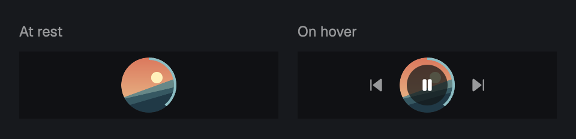

# Herdr Player

A spinning album cover in your Herdr sidebar. Hover to reveal previous, play/pause and next. The colored arc marks elapsed time. A small ♪ occasionally rises from the playing disc and fades when the controls are tucked away.



## Install on macOS

1. Install the local playback tools with `brew install media-control ffmpeg`. Check that macOS is exposing your session with `media-control test` and `media-control get --no-artwork`.
2. Copy `mods/music-deck/` into your Herdr app home's `mods/` directory. If you already have a custom mod with that name, review the files before replacing it.
3. In a personal layout, group the sidebar footer and player in a horizontal row. This puts the disc beside Settings and Add machine. Keep the footer mod and props your layout uses. Here is an example for a clone of Herdr’s main layout.

```json
{
  "id": "sidebar-utilities",
  "type": "row",
  "size": { "px": 69 },
  "resizable": false,
  "children": [
    {
      "id": "sidebar-footer", "type": "block", "min": 28,
      "size": { "weight": 1 },
      "content": { "mod": "workspace-chrome", "props": { "footer": true } }
    },
    {
      "id": "music-deck", "type": "block", "min": 46, "max": 122,
      "size": { "weight": 1 }, "content": { "mod": "music-deck" }
    }
  ]
}
```

4. Optionally merge the binding in `keys.json` into your Herdr keys. Check the installation with `herdr-app check ~/.config/herdr-app/mods/music-deck`.

## Controls

| Action | Gesture |
| --- | --- |
| Play or pause | Click the cover or press Space/Enter while the row has focus |
| Previous or next | Hover and click the arrows, or use Left/Right with the row focused |
| Seek | Drag the outer rim and release |
| Open playlists | Right-click the row, click the idle cover, or press ⌘⇧Y with the supplied binding |
| Save a playlist | Choose **Save a playlist**, enter a name and paste a YouTube Music playlist link |

Playback follows the active macOS Now Playing session, including supported browser tabs. Hover over the center for the title, artist and source. Playback and seeking depend on the commands that the active app supports. Playlist links open in Google Chrome through macOS. Chrome's Apple Events JavaScript setting is unnecessary.

The mod checks local playback with [media-control](https://github.com/ungive/media-control). It uses FFmpeg to prepare a small rotating image from the cover, then lets Herdr animate it. Pausing selects the still cover. A session without artwork gets a music mark while playing and initials when paused. Set `"props": { "spin": false }` inside the block's `content` to prefer still artwork.

Covers are cached under `data/music-deck/covers/` inside the Herdr app home. Saved playlist names and links stay in Herdr's local shared state. The mod downloads no artwork and makes no network requests itself.

See the [gallery recipe](RECIPE.md) for rebuild and verification details. The transport icons come from [the community YouTube Music mod](https://github.com/cybertron288/herdr-mods/tree/main/yt-music). License notices are included alongside the icons.
