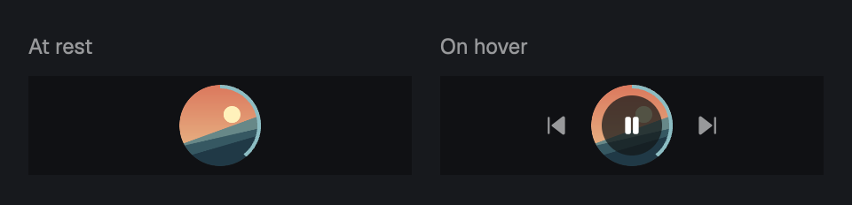

# Music Ring

Put a single round record in the right side of the Herdr sidebar footer. The photo turns while music plays. About every seven seconds four 12 px notes (♪ ♫ ♩ ♬) rise from the cover. Stagger their entrances by 650 ms and vary their paths slightly. Each fades over 1.3 seconds. Hide them when paused, hovered or focused. Hovering reveals three transport controls without moving the cover.

## What you see

Center a 46 px cover in the right-hand lane of a 69 px footer on the sidebar's chrome background. Overlay a 2 px elapsed arc clockwise from the top. Leave the rest of the circumference open. Use the theme's cyan for the arc. Reserve up to 30 px on either side for transport. In a folded rail, prioritize the disc and keep keyboard transport. At rest the only visible element is the disc.

## How it behaves

Hover or focus the row to reveal the previous and next buttons and a translucent play/pause button on the photo. The tooltip identifies the song, artist and source app. Dragging the outer rim previews the target time and sends one seek on release. The focused row handles Space, Enter and the left/right arrows. With no session, the center opens playlists. Right-clicking always opens the picker.

The picker includes the YouTube Music library, Liked Music and locally saved links. Adding an existing playlist ID updates its name. Removing a saved link only removes it from Herdr.

## Built from

Group the existing footer and a `music-deck` block in a horizontal row. Give both lanes equal layout weight and cap the music block at 122 px. Its optional `spin` prop defaults to true. The same mod renders a dialog when opened as an overlay. Include an optional global shortcut for `mod.open:music-deck`.

Read macOS Now Playing metadata using `exec` and `media-control get --now --no-artwork`. Fetch artwork on track changes and retry missing artwork periodically. Keep track identity with each picture. Use compact content-addressed files under the app's data directory and rotate the color artwork in a cached FFmpeg loop at 30 fps, one revolution every 16 seconds. Draw playback progress separately with GPUI's PathBuilder. Store playlist names and validated YouTube playlist IDs with `shared` and `setShared`. Open canonical playlist URLs with `/usr/bin/open` and Google Chrome's bundle ID.

## Watch out

Check for Homebrew tools on Intel and Apple Silicon. Keep subprocess and disk activity out of headless checks. A browser can publish metadata late or omit album art, duration or transport commands. Keep the picker usable when the player is idle or unavailable. macOS Reduce Motion and the window's active state may affect animated images. A static photo is sufficient when FFmpeg is absent.

## Done when

- `herdr-app check ~/.config/herdr-app/mods/music-deck` passes and Herdr displays the row beside the footer controls.
- Starting and pausing a supported media session switches between moving and still art. Media with no cover shows a fallback.
- Hovering reveals controls without shifting the record. Transport and rim-seek target the active media session.
- A saved playlist survives closing and reopening the picker and opens in Chrome.
